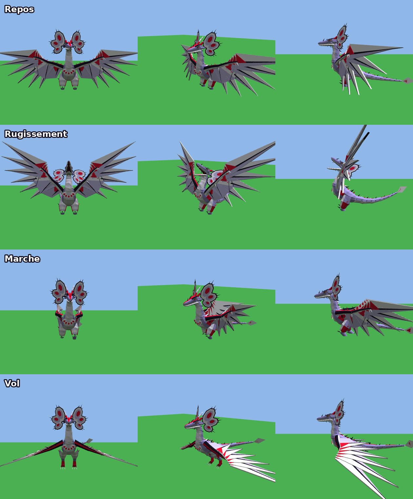
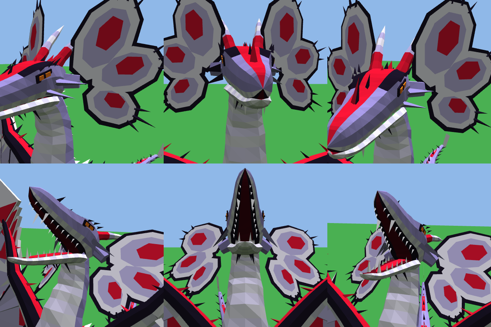

# Kirasa pour Roblox (low poly)

Kirasa est un dragon debout à long cou, en facettes low poly, avec des ailes à lames.
Elle est animée : **repos**, **marche**, **décollage**, **vol** (battements et vol plané), **atterrissage**.
Au repos, elle fait des actions au hasard : **rugir** (elle ouvre la gueule), **s'étirer** (avec un bâillement), **regarder autour d'elle**, **secouer la tête**.

## Installation recommandée : modèle 3D (sans aucune jointure)

Il faut **Roblox Studio sur ordinateur**, connecté à ton compte.

1. Télécharge [`Kirasa.obj`](Kirasa.obj) (bouton « Download raw file » sur GitHub).
2. Dans Roblox Studio, ouvre l'outil **Importer 3D** (Import 3D), puis choisis `Kirasa.obj`.
   Dans les réglages d'import, laisse **Fusionner les maillages** (Merge Meshes) **décoché**, puis clique sur **Importer**.
3. Menu **Affichage** (View), puis **Barre de commande** (Command Bar).
4. Copie tout le contenu de [`KirasaRig.lua`](KirasaRig.lua), colle-le dans la barre de commande, puis appuie sur **Entrée**.
   Le script retrouve les 116 morceaux importés, leur donne leurs couleurs, construit le squelette et ajoute les animations.
5. Clique sur **Jouer** (Play) pour la voir bouger. Avec **Exécuter** (Run), elle reste immobile, car les animations sont calculées chez le joueur.

Kirasa est alors faite de 116 morceaux de maillage (environ 5 500 triangles, avec relief sculpté, écailles du ventre et rangées d'épines) : ça reste léger pour le jeu.

Si le script affiche « je ne trouve pas le morceau… », l'import a sûrement fusionné les maillages : supprime le modèle importé et recommence l'étape 2 avec **Fusionner les maillages** décoché.

## Autre installation : pièces Roblox (sans import)

Colle tout [`KirasaBuilder.lua`](KirasaBuilder.lua) dans la barre de commande. Kirasa est alors construite avec environ 1 700 pièces Roblox, dans une version plus simple (sans le relief ni les détails du modèle 3D). C'est plus lourd, et on voit de fines lignes entre les triangles.

## Réglages

Sélectionne le modèle `Kirasa` dans l'Explorer, puis change ses **attributs** dans les Propriétés :

| Attribut | Rôle |
|---|---|
| `AutoWander` | Coché : elle se promène toute seule (pauses, marche, vols). Décoché : elle reste sur place et joue l'animation de `Mode`. |
| `Mode` | `Idle` (repos), `Walk` (marche) ou `Fly` (vol). Elle décolle et atterrit toute seule quand tu passes de l'un à l'autre. |
| `PlayAction` | Écris `Roar`, `Stretch`, `Look` ou `Shake` (pendant le jeu) pour lancer une action quand elle est au repos. |
| `WalkSpeed`, `FlySpeed` | Vitesse de marche et de vol. |
| `WanderRadius` | Distance maximale autour de son point de départ. |
| `FlyHeight` | Hauteur de vol. |

Pour changer ses couleurs, modifie le tableau `COLORS` en haut de `KirasaRig.lua` avant de le coller (`back` pour le dos, `belly` pour le ventre, `red` pour les marques…).

Kirasa mesure environ 26 studs de haut. Pour la changer de taille, utilise l'outil Échelle (Scale) de Studio sur le modèle importé **avant** de coller `KirasaRig.lua`.

## Fichiers

- `Kirasa.obj` + `KirasaRig.lua` : version maillage 3D, générés par `python3 make.py`.
- `KirasaBuilder.lua` : version en pièces Roblox, générée par `python3 make.py`.
- `src/build.lua` : la forme du dragon (anneaux, facettes, pointes), utilisée par les deux versions.
- `src/rig.lua` : assemblage du modèle importé (couleurs, squelette, scripts).
- `src/brain.server.lua` : script serveur, il choisit où elle va, quand elle vole et quelle action elle fait.
- `src/pose.client.lua` : script client, il calcule les animations chez chaque joueur pour qu'elles soient fluides.
- `tools/` : imitation minimale de Roblox pour lancer `build.lua` hors de Studio et exporter le maillage (`make.py` utilise l'interpréteur `luau`).
